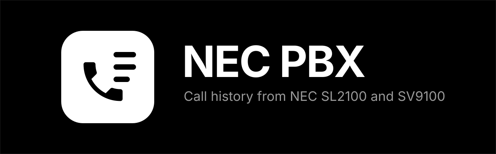

  

  
  
  
  
  

  <b>Who called, which room answered and what was missed, from your NEC SL2100 or SV9100.</b> 
  Reads the phone system's built-in call log over your network, so <b>no CTI licence, cloud or extra software is needed.</b>

  
  &nbsp;
  

  <a href="https://github.com/olliemaller/ha-nec-pbx/blob/main/docs/Installation.md">Install</a> ·
  <a href="https://github.com/olliemaller/ha-nec-pbx/blob/main/docs/Setup.md">Set up</a> ·
  <a href="https://github.com/olliemaller/ha-nec-pbx/blob/main/docs/Features.md">Features</a> ·
  <a href="https://github.com/olliemaller/ha-nec-pbx/blob/main/docs/Automations.md">Automations</a> ·
  <a href="https://github.com/olliemaller/ha-nec-pbx/blob/main/docs/Troubleshooting.md">Troubleshooting</a> ·
  <a href="https://github.com/olliemaller/ha-nec-pbx/blob/main/docs/README.md">All docs</a>

---

> [!IMPORTANT]
> **Unofficial.** Not affiliated with or endorsed by NEC. "NEC", "SL2100" and "SV9100" are trademarks of their owner, used here only to describe compatibility.

> [!NOTE]
> The phone system writes a call record **when a call ends**. This integration tells you about finished and missed calls, not "the phone is ringing now". Live ringing needs NEC's paid CTI licence.

## What you get

| | |
|---|---|
| **Last call** | When it was, in or out, the number, the caller's name, the room, how long it lasted and whether it was answered. |
| **Missed calls** | A "Last missed call" sensor and a `nec_pbx_missed_call` event for notifications. |
| **Every room** | A "last call" sensor for each extension you name, such as *Oliver last call*. |
| **Daily counts** | Calls today and missed calls today, reset at midnight. |
| **Recent calls** | The last 20 calls as a list, ready for a dashboard card. |
| **Names, not numbers** | A phonebook in the options puts names on callers. |
| **[Automations](https://github.com/olliemaller/ha-nec-pbx/blob/main/docs/Automations.md)** | `nec_pbx_call` and `nec_pbx_missed_call` events with everything about the call. |
| **Fast and local** | Pushed from the phone system the moment a call ends. Reconnects by itself. No cloud. |
| **Private diagnostics** | Phone numbers are masked in diagnostics, so you can share them safely. |

## Quick start

1. **Check the phone system** is sending its call log over the network. On SL2100 these are the defaults: Program 35-01-01 *Output port* = LAN, and Program 10-20 *SMDR Output* port (4001 on Australian systems). [Details](https://github.com/olliemaller/ha-nec-pbx/blob/main/docs/Setup.md).
2. **Install** from the Marketplace (Home Assistant 2026.11+) or HACS with the button above. [Other ways](https://github.com/olliemaller/ha-nec-pbx/blob/main/docs/Installation.md).
3. **Add the integration** with the phone system's IP address and the SMDR port.
4. **Name your rooms** under **Configure**, one per line, like `103: Oliver`, and add a phonebook, like `0412 345 678: Mum`.

Needs an NEC SL2100 or SV9100 on your network, and Home Assistant 2025.6 or newer. Tested on an SL2100 (Australian, software 5.21). Please [tell us how it went](https://github.com/olliemaller/ha-nec-pbx/issues/new) on yours.

## Help and contributing

- Something not working? See [Troubleshooting](https://github.com/olliemaller/ha-nec-pbx/blob/main/docs/Troubleshooting.md), then [open an issue](https://github.com/olliemaller/ha-nec-pbx/issues/new) with your diagnostics attached.
- A call read wrongly? The diagnostics include the raw call-log line with numbers masked. That line is all that's needed to add your system's layout.
- Want to help? See [Development](https://github.com/olliemaller/ha-nec-pbx/blob/main/docs/Development.md).

## Licence

[MIT](https://github.com/olliemaller/ha-nec-pbx/blob/main/LICENSE). See also [NOTICE](https://github.com/olliemaller/ha-nec-pbx/blob/main/NOTICE).
